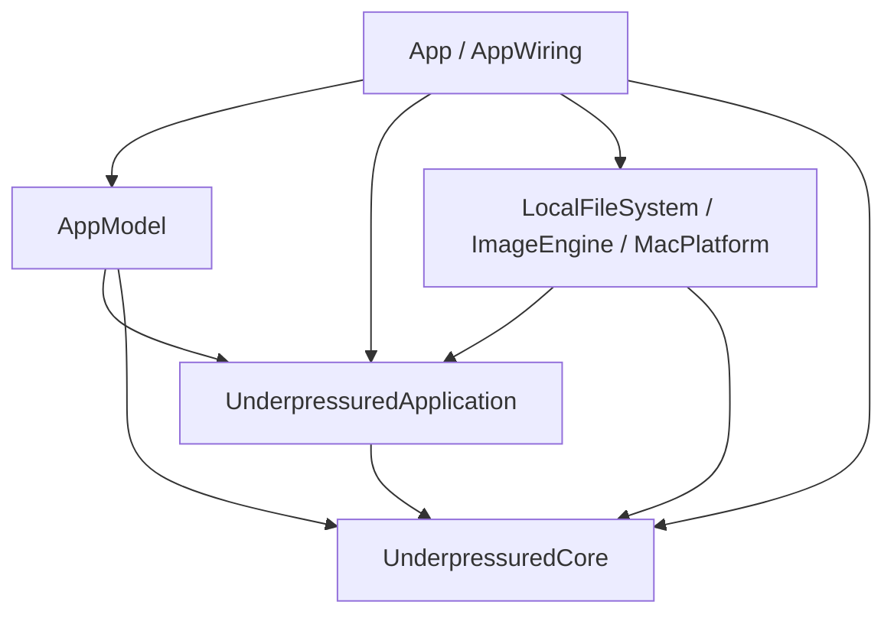

# Architecture

Underpressured has one Image Optimization domain. Presets and processing share this model.
Domain types enforce product rules. Application services coordinate work through ports. Platform adapters implement those ports.
Presentation owns UI state, localized text, focus, and undo.

## Modules and source locations

Package paths below are relative to `Packages/UnderpressuredKit/Sources/`.

| Location                                            | Owner and responsibility                                                                                          |
| --------------------------------------------------- | ----------------------------------------------------------------------------------------------------------------- |
| `UnderpressuredCore/`                               | Presets, constrained values, captured batch settings, source facts, outcomes, format decisions, and mark matching |
| `UnderpressuredApplication/ProcessingSession.swift` | Intake order, pending scans, folder-access requests, cancellation generations, Run activity, and idle operations |
| `UnderpressuredApplication/Queue/`                  | Atomic admission, source exclusion, execution records, worker cancellation, and pixel accounting                  |
| `UnderpressuredApplication/Pipeline/`               | Processing stages and file-commit sequencing                                                                      |
| `UnderpressuredApplication/Rules/`                  | Folder scanning, output-path planning, and the folders a conversion beside a loose file needs                    |
| `UnderpressuredApplication/Boundaries/`             | File, codec, and folder-access ports                                                                              |
| `AppModel/`                                         | Observable projections, preset interactions, selection, localization, and undo                                    |
| `LocalFileSystem/`                                  | File operations, OS content classification, and optimization-mark serialization                                   |
| `ImageEngine/`                                      | ImageIO transforms, native codec wrappers, JPEG rewriting, and PNG palette search                                 |
| `MacPlatform/`                                      | Saved-settings mappings, notifications, sleep prevention, and processor probes                                    |
| `SoakHarness/`                                      | Executable for soak and performance scripts                                                                       |

`App/` contains SwiftUI views, AppKit integration, dialogs, the folder-access panel, and Quick Look.
`App/AppWiring.swift` constructs the model, services, and adapters.
`native/up-jpegli/` and `rust/up-codecs/` provide C interfaces to the native codecs.
`Vendor/` contains generated XCFrameworks and is excluded from Git.

## Dependency rules

Arrows mean imports. ImageEngine also imports the native codec targets.
Core can use Foundation values such as `URL`, `UUID`, `Date`, and `Data`.
Core must not access files, UserDefaults, system probes, codec implementations, or task scheduling.
Application code defines ports and platform-service contracts. Adapters must not import AppModel.
Presentation supplies localized notification and sleep-prevention text through application contracts.

`scripts/check-architecture.py` checks target dependencies, source locations, and imports.
Review public APIs and effects as well. Import checks cannot prove correct ownership.

## Product rules and execution ownership

`PresetList` owns membership, order, and one active member. It contains 1 to 20 presets with distinct IDs.
Names contain 1 to 70 Unicode grapheme clusters. Quality is 0 to 100. Resize limits are positive.
Construction, restoration, and public mutations preserve these rules. Duplicate names are valid.

Each batch captures its preset label, settings, output format, identity, and destination before scanning.
Later preset edits cannot change that capture.
Item source facts are immutable. Mutable batch items and row states are consumer-owned values.
Queue owns the authoritative execution records and terminal transitions.

Queue rejects duplicate candidate item IDs and active batch or item ID collisions before events or source reservations.
IDs can be reused after execution records retire.
Source exclusion recognizes normalized paths and underlying files, including hard links.
Each item receives one terminal outcome.

## Run and queue lifetimes

A product Run starts with valid, nonempty intake from idle.
It ends when pending scans, admissions, and unfinished items settle.
A temporary queue drain does not end a Run while intake remains pending.
Run totals drive progress and background completion notifications. The completion banner summarizes retained history across Runs.

A queue execution interval starts at admission and ends when admitted work drains.
`QueueExecutionContext` owns output reservations and folder checks for that interval.
Active workers retain the context through cancellation until they return.
Batch captures and presentation events contain no execution context.

Later intervals use fresh reservations and can refresh a valid marked export, including within the same Run.
Existing files protect paths between intervals. See [destination rules](SPEC.md#6-destination).

## Processing flow

1. AppModel forwards Open, drops, and Open With to ProcessingSession.
2. ProcessingSession captures settings and scans outside the main actor in intake order.
3. Queue admits batches and schedules items.
4. Pipeline checks marks, inspects pixels, reserves memory, transforms, encodes, and commits through FileAccess.
5. ProcessingSession consumes queue events without the UI throttle and forwards immutable events to AppModel.

ProcessingSession owns cancellation generations and rejects late scan results after cancellation.
Exclusive idle reservations lock intake synchronously and remain held until explicit release.
Quit and update installation use this same coordinator.

AppModel coalesces row updates at 100 ms intervals. The first event and queue idle flush immediately.
Run completion flushes terminal rows before presentation creates a summary or notification.

Parallelism uses the performance-core count, with the active processor count as fallback.
The default pixel budget is 120 megapixels. Pixel reservations use FIFO order. An image above the budget runs alone.
Codec work runs outside the caller's task. Cancellation stops processing between stages.
Native failures use an ImageIO fallback only when it meets the requested fidelity contract.

## Files and storage

Temporary files use the destination volume. LocalFileSystem writes them to one item-replacement folder per volume, because a sandboxed app may have access to a target file but not to its folder. When a volume offers no such folder, the temporary file goes next to the target. Commit rechecks source identity, size, and modification date.
Marked replacement also requires the expected destination version.
A dropped file grants a sandboxed app that file, not its folder. Before admission, ProcessingSession asks the `FolderAccess` port for each folder in which Replace Originals will create a converted file beside a loose source and where the app cannot create files. `SiblingOutputFolders` selects the folders from each Item's scanned format. The Queue and Pipeline never wait for the user. `App/FolderAccessPanel.swift` implements the port with `NSOpenPanel`. Its check uses `access(2)`, which reports sandbox grants, so it needs no sandbox API. Tests and the default use `UnrestrictedFolderAccess`. A refused panel leaves commit semantics unchanged: the conversion fails with No permission.
Before scanning, ProcessingSession also asks the port for a captured Export folder that the app cannot write. `FolderAccessPurpose` tells the panel which message to show. After a grant, the session emits `exportFolderGranted`, and AppModel saves the settings again. MacPlatform then rebuilds the bookmark, because the earlier one granted no access.
Each file commits independently. Cancellation and later source-cleanup failures cannot remove a committed output.

MacPlatform maps versioned settings into valid domain values. It stores the Export folder as a security-scoped bookmark and as the plain path that earlier builds read. It uses the path when the bookmark is missing or cannot be resolved. It keeps security-scoped access to a resolved folder for the life of the process. A resolved bookmark that grants no access is rebuilt on the next save.
`Resources/container-migration.plist` ships only in `UnderpressuredUpdaterFree`. It moves the direct build's preferences file into the sandbox container on first launch, so the same keys load there. A bookmark that the direct build saved grants no sandbox access, so the migrated Export folder works as a path only. LocalFileSystem owns versioned JSON and optimization-mark extended attributes.
Application commit tokens retain opaque expected mark bytes.
Preserve stored keys, preset IDs, order, starter identifiers, legacy defaults, and compatible mark payloads.
Batch and item execution state does not persist.
See [stored preset recovery](SPEC.md#stored-preset-recovery) for fallback rules.

## Native dependencies

`scripts/build-deps.sh` pins jpegli and builds the XCFrameworks. Rust pins live in `rust/up-codecs/Cargo.lock`.
The build stamp includes native sources and dependency inputs. Framework headers belong under each module directory.

cbindgen generates `rust/up-codecs/include/up_codecs.h`. Commit the header when its API changes.
Release jpegli buffers with `upj_buffer_free`. Release Rust buffers with `up_buffer_free`.

## Change requirements

Update the [glossary](GLOSSARY.md), [behavior specification](SPEC.md), and this guide when language, behavior, or ownership changes.
Check construction, public mutation, and storage restoration paths.
Use the [development workflow](development.md#change-workflow) for validation.
Manual acceptance remains pending until recorded in the [native interaction checks](development.md#native-gestures-and-voiceover) and [release build checks](release.md#release-build-checks).
