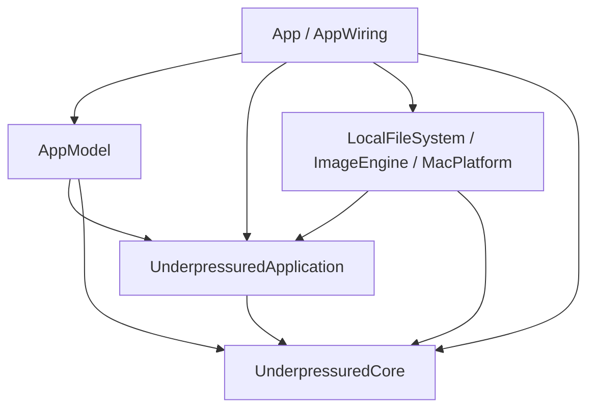

# Architecture

Underpressured has one domain: Image Optimization. Presets and processing use the same model. There are four layers:

- Domain types (Core) enforce the product rules.
- Application services control the work through ports.
- Platform adapters implement the ports.
- Presentation (AppModel) owns UI state, localized text, focus, and undo.

## Modules

Package paths are relative to `Packages/UnderpressuredKit/Sources/`.

| Location | Owns |
| --- | --- |
| `UnderpressuredCore/` | Presets, value limits, captured batch settings, source facts, outcomes, format decisions, and mark matching |
| `UnderpressuredApplication/ProcessingSession.swift` | Intake order, pending scans, folder-access requests, cancellation generations, Run activity, and idle operations |
| `UnderpressuredApplication/Queue/` | Atomic admission, source exclusion, execution records, worker cancellation, and the pixel budget |
| `UnderpressuredApplication/Pipeline/` | Processing stages and the file-commit sequence |
| `UnderpressuredApplication/Rules/` | Folder scan, output-path plan, and the folders that a conversion next to a loose file needs |
| `UnderpressuredApplication/Boundaries/` | File, codec, and folder-access ports |
| `AppModel/` | Observable UI state, preset interactions, selection, localization, and undo |
| `LocalFileSystem/` | File operations, content type detection, and optimization-mark storage |
| `ImageEngine/` | ImageIO transforms, native codec wrappers, JPEG rewrite, and PNG palette search |
| `MacPlatform/` | Saved settings, notifications, sleep prevention, and processor detection |
| `SoakHarness/` | Executable for the soak and performance scripts |

Other locations:

- `App/` has the SwiftUI views, AppKit integration, dialogs, the folder-access panel, and Quick Look.
- `App/AppWiring.swift` makes the model, the services, and the adapters, and connects them.
- `native/up-jpegli/` and `rust/up-codecs/` give C interfaces to the native codecs.
- `Vendor/` has the generated XCFrameworks. Git ignores it.

## Dependency rules

An arrow means "imports". ImageEngine also imports the native codec targets.

- Core can use Foundation values, such as `URL`, `UUID`, `Date`, and `Data`.
- Core must not use files, UserDefaults, system probes, codec code, or task scheduling.
- Application defines the ports and the platform-service contracts.
- Adapters must not import AppModel.
- Presentation gives the localized notification and sleep-prevention text to Application through its contracts.

`scripts/check-architecture.py` checks target dependencies, source locations, and imports. Import checks cannot prove correct ownership, so also review public APIs and effects.

## Ownership rules

- `PresetList` owns the members, their order, and the one active member. Construction, restoration from storage, and each public mutation keep the [preset limits](SPEC.md#values).
- Each batch captures its preset settings and destination before the scan. Later preset edits do not change the capture.
- Item source facts never change. Batch items and row states that change are values that each consumer owns.
- Queue owns the authoritative execution records and the final state change of each item.
- Before Queue sends events or reserves sources, it rejects a batch with duplicate item IDs, or with batch or item IDs that active execution uses. An ID can be used again after its execution record retires.
- Source exclusion recognizes normalized paths and the underlying file, including hard links.
- Each item gets exactly one outcome.

## Run and queue lifetimes

A [Run](GLOSSARY.md#processing) and a queue execution interval are different lifetimes. Do not mix their identities. A Run includes pending intake, so an empty queue does not end a Run while a scan is pending. ProcessingSession tracks the Run.

- `QueueExecutionContext` owns the output reservations and the folder checks for one interval.
- Active workers keep the context until they return, also after a cancellation.
- Batch captures and presentation events do not contain the context.
- A later interval gets new reservations. It can replace a valid marked export, also in the same Run. Between intervals, existing files protect the paths. See the [destination rules](SPEC.md#5-destination).

## Processing flow

1. AppModel sends Open, drops, and Open With to ProcessingSession.
2. ProcessingSession captures the settings. It scans outside the main actor, in intake order.
3. Queue admits batches and schedules items.
4. Pipeline checks marks, inspects pixels, reserves memory, transforms, encodes, and commits through FileAccess.
5. ProcessingSession receives queue events without the UI throttle. It sends events that never change to AppModel.

Coordination:

- ProcessingSession owns cancellation generations. It ignores scan results that arrive after a cancellation.
- An exclusive idle reservation locks intake at once. It stays until an explicit release. Quit and update installation use this reservation.
- AppModel combines row updates into 100 ms intervals. The first event and queue idle apply immediately. At the end of a Run, the final rows apply before the summary or notification.

Resources:

- Parallel work uses the performance-core count. If that is not available, it uses the active processor count.
- The default pixel budget is 120 megapixels. Pixel reservations are first in, first out. An image larger than the budget processes alone.
- Codec work runs outside the caller's task. Cancellation stops processing between stages.
- If a native codec fails, ImageIO is used only if it meets the requested fidelity.

## Files

- Temporary files are on the destination volume. LocalFileSystem writes them in one item-replacement folder for each volume, because a sandboxed app can have access to a file but not to its folder. If a volume has no such folder, the temporary file goes next to the target.
- At commit, the app checks the source identity, size, and modification date again. A replacement of a marked file also needs the expected destination version.
- Each file commits on its own. A cancellation or a later source-cleanup failure cannot remove a committed output.

### Folder access

The `FolderAccess` port asks the user for folder access. [Destination](SPEC.md#folder-access-in-the-sandboxed-app) describes when. Only ProcessingSession calls the port, so Queue and Pipeline never wait for the user.

- `SiblingOutputFolders` finds the folders that a conversion needs, from each Item's scanned format.
- `FolderAccessPurpose` tells the panel which message to show.
- After an Export folder grant, the session sends `exportFolderGranted`. AppModel saves the settings again, and MacPlatform makes a new bookmark.
- `App/FolderAccessPanel.swift` implements the port with `NSOpenPanel`. Its check uses `access(2)`, which reports sandbox grants, so it needs no sandbox API.
- Tests and the default wiring use `UnrestrictedFolderAccess`.
- A refusal does not change commit rules.

## Storage

- MacPlatform maps versioned settings into valid domain values. See [stored preset recovery](SPEC.md#stored-preset-recovery).
- MacPlatform stores the Export folder two ways: as a security-scoped bookmark, and as the plain path that older builds read. If the bookmark is missing or does not resolve, it uses the path. It keeps security-scoped access to a resolved folder while the process runs. If a resolved bookmark gives no access, the next save makes a new one.
- `Resources/container-migration.plist` ships only in `UnderpressuredUpdaterFree`. On the first launch, it moves the direct build's preferences file into the sandbox container, so the same keys load there. A bookmark from the direct build gives no sandbox access, so the migrated Export folder works only as a path.
- LocalFileSystem owns the versioned JSON and the optimization-mark extended attributes. Application commit tokens keep the expected mark bytes without reading them.
- Keep stored keys, preset IDs, order, starter identifiers, old defaults, and compatible mark payloads.
- Batch and item execution state is not saved.

## Native dependencies

- `scripts/build-deps.sh` pins jpegli and builds the XCFrameworks. `rust/up-codecs/Cargo.lock` pins the Rust crates.
- The build stamp includes native sources and dependency inputs. Framework headers go in each module directory.
- cbindgen makes `rust/up-codecs/include/up_codecs.h`. Commit the header when its API changes.
- Free jpegli buffers with `upj_buffer_free`. Free Rust buffers with `up_buffer_free`.
